  
   
  
   
  <i>A sarcastic cinephile and anthropoid.</i>

---

## 🎓 About Me

- 🎓 First-year **BTech CSE** student at **MITWPU, Pune**
- 🔧 Building **GASLIGHTR** — a native Photoshop enhancement plugin for neural rendering
- 🎮 Cut my teeth as a **gameplay engineer**, shipping systems for two indie titles
- 🎬 Chasing a career at the intersection of **code and cinema**
- 📹 Taught game dev on **YouTube** and sold code packs through **Patreon**

---

## 🎞️ The Journey

| | |
|---|---|
| 🎥 **YouTube** | Started a channel teaching advanced game-dev techniques to fellow developers |
| 💰 **Patreon** | Turned that into a monthly code-pack subscription |
| 🕹️ **Junior → Lead Gameplay Engineer** | Hired through Patreon by a US studio, promoted after proving out real systems |
| 🧟 **Zombie Survival MP** | A multiplayer survival title — shelved when server funding ran out |
| 🎬 **A 2-Year Campaign** | A story driven campaign game, two years deep — paused when investors pulled back |

---

## 🚀 Featured Build

### VERTEBRATE
<i>A locally-hosted, real-time human fall detection system</i>

Runs a local **YOLO11n pose** pipeline in a background **QThread**, combining body geometry with a debounced posture heuristic before sending copied frames and alert state to a **PySide6** GUI through Qt signals. The camera and model remain owned by the worker, while the main thread owns every widget and limits the interface to one pending frame.

- 🎯 Local CPU inference from webcam input with no footage upload or recording
- 🧮 Fall posture heuristic based on bounding-box aspect ratio and shoulder-to-hip geometry
- 🚦 Scene-wide debounce requiring five consecutive processed frames before alerting
- 🧵 Cooperative Start/Stop lifecycle with camera release handled during worker shutdown
- ✅ Red/green OpenCV skeleton overlays and a live **FALL DETECTED** banner

  
  
  
  

---

## 🛠️ Tech Stack

### 🕹️ Game Dev & 3D

  
  

### 🐍 Languages & Computer Vision

  
  

### 🎬 Creative & Post-Production

  
  

### 🛠️ Environment & Tools

  
  

---

## 📊 Stats

  
  &nbsp;
  

---

## 🌐 Connect

  
  
  

---

## 🐍 Contribution Snake

  
  

 

engineered in code, directed in daydreams

